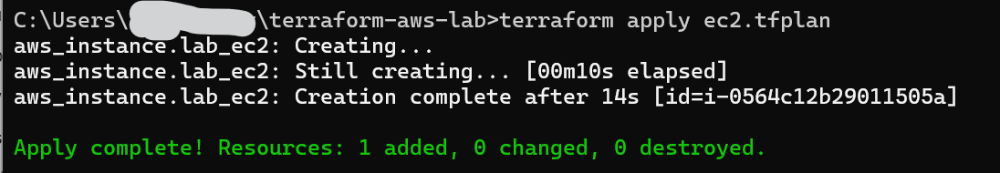
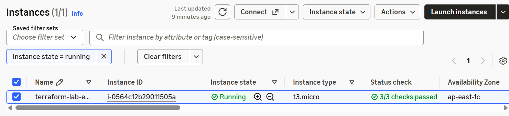
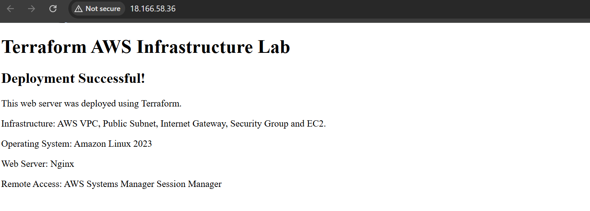
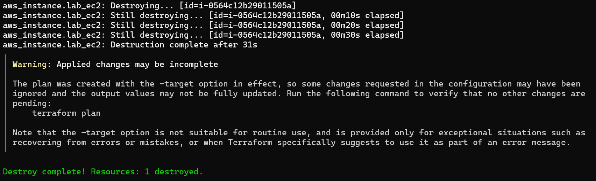

# terraform-aws-infrastructure-lab

## Project Overview
This project demonstrates provisioning AWS infrastructure using Terraform and deploying an Amazon Linux 2023 web server.
The infrastructure was deployed in the AWS Hong Kong Region (ap-east-1). The EC2 instance was accessed securely using AWS Systems Manager Session Manager, without opening SSH port 22.

## AWS Services and Tools
- Terraform (Infrastructure as Code)
- Amazon VPC, public subnet, internet gateway and route table
- Amazon EC2 (t3.micro)
- Amazon EBS (encrypted gp3 root volume)
- AWS IAM
- AWS Systems Manager Session Manager
- Amazon Linux 2023
- Nginx
- AWS CLI
- Infrastructure Architecture

## The infrastructure consists of:
| Component | Configuration |
| :--- | :--- |
| **VPC** | 10.0.0.0/14 |
| **Public Subnet** | 10.0.1.0/24 |
| **Internet Gateway** | Attached to the VPC |

 
An internet gateway attached to the VPC.
A route table with a default route to the internet gateway.
A security group allowing inbound HTTP (port 80) and outbound HTTPS (port 443).
An Amazon Linux 2023 EC2 instance with a public IPv4 address.
An IAM instance profile enabling AWS Systems Manager Session Manager access.
The VPC, subnet, internet gateway, routing, security group and EC2 instance were provisioned using Terraform. The IAM role, instance profile and deployment permissions were configured separately in the AWS Console.

## Deployment and Testing
1. Initialized and validated the Terraform configuration.
2. Reviewed the execution plan before deployment.
3. Successfully deployed the EC2 instance using terraform apply.
4. Connected to the EC2 instance through Session Manager.
5. Installed and started Nginx manually.
6. Verified that Nginx returned HTTP/1.1 200 OK.
7. Accessed the Nginx homepage using the EC2 public IPv4 address.
8. Replaced the default homepage with a customized Terraform infrastructure lab page.
9. Captured deployment screenshots.
10. Destroyed the EC2 instance using Terraform after testing.

## Screenshots

---

---

---

## Security Considerations
- Used a dedicated IAM user for Terraform deployment.
- Restricted EC2 instance type to t3.micro through IAM permissions.
- Used Session Manager instead of SSH.
- Did not expose port 22.
- Enabled EBS encryption.
- Used Terraform resource tags to identify lab infrastructure.
- Excluded Terraform state files and credentials from Git version control.
The IAM permissions used for this learning lab are not a complete production-grade least-privilege implementation.

## Cost Management
An AWS Budget alert was configured to monitor spending. The EC2 instance was terminated after testing to reduce ongoing costs.

AWS Budgets alerts do not automatically prevent charges.

## Future Improvements
- Automate Nginx installation using EC2 user data.
- Manage IAM roles and instance profiles using Terraform.
- Add CloudWatch monitoring and alarms.
- Introduce a private subnet.
- Improve IAM least-privilege restrictions.
- Configure HTTPS using a domain and TLS certificate.

## Lessons Learned
This project provided practical experience with Terraform resource dependencies, AWS networking, IAM permissions, EC2 provisioning, Linux administration, Systems Manager connectivity and troubleshooting Terraform configuration drift.
